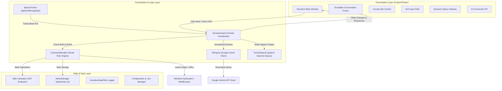
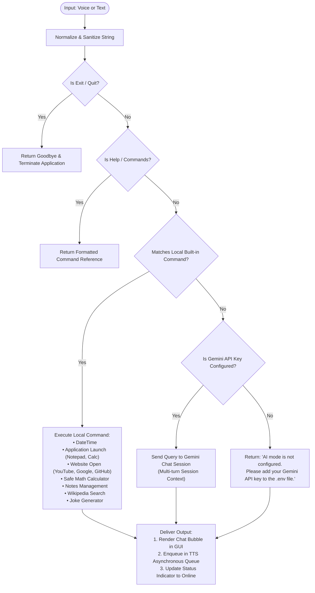
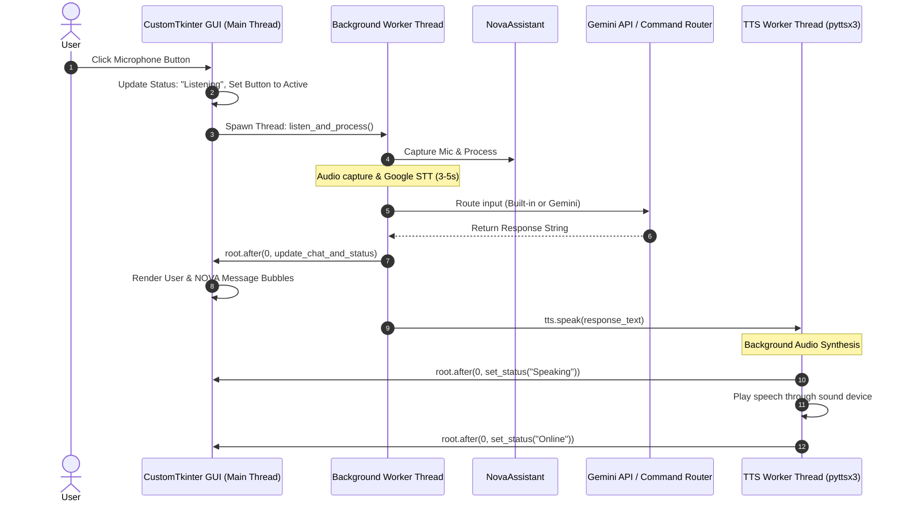
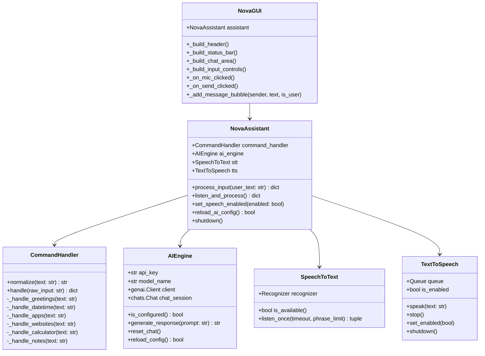

# NOVA System Architecture & Design Specification

This document provides a comprehensive technical breakdown of the architectural design, component interactions, concurrency patterns, and security principles implemented in **NOVA – AI-Powered Virtual Assistant**.

---

## 1. Architectural Overview

NOVA follows a **Layered Architecture** with an **Event-Driven Asynchronous Pipeline**. Responsibilities are partitioned into isolated modules to maintain high cohesion and low coupling.



---

## 2. Smart Command Routing Pipeline

When an input event (spoken or typed) is received, NOVA processes it through a strict tiered hierarchy to minimize API costs, avoid unnecessary latency, and maintain predictable system behavior:



---

## 3. Asynchronous Concurrency Model

A major architectural challenge in desktop assistants is preventing blocking calls during audio capture, speech synthesis, and remote API calls. NOVA addresses this by running all time-intensive tasks on dedicated background threads:



---

## 4. Class & Component Structure



---

## 5. Security Architecture

1. **Zero Unsafe `eval()` / `exec()` Execution:**
   - Mathematical expressions are parsed strictly into Abstract Syntax Trees using Python's `ast.parse(expr, mode='eval')`.
   - Only approved nodes (`ast.Constant`, `ast.BinOp`, `ast.UnaryOp`, `ast.Call`) and safe functions (`sqrt`, `sin`, `log`, etc.) are evaluated.
   - Code injection attempts like `__import__('os').system(...)` are rejected at the AST root.

2. **Strict Application Whitelisting:**
   - Operating system application launching is restricted to approved system tools: `notepad.exe` and `calc.exe`.
   - General shell execution of arbitrary commands from spoken text is strictly blocked.

3. **API Key Isolation & Redaction:**
   - API keys are never stored in source code; they are loaded via `.env` files.
   - `.env` is excluded in `.gitignore` to prevent accidental version control commits.
   - `utils.logger.SensitiveDataFilter` runs a regex pass on all log messages, masking any detected API key patterns before writing to `logs/nova.log`.

---

## 6. Directory Layout & Module Responsibilities

```
NOVA/
├── main.py                  # CLI / GUI entry point
├── config.py                # Environment and styling configuration
├── requirements.txt         # Core dependencies
├── launch.bat               # Windows one-click launcher
├── .env.example             # Configuration template
├── .gitignore               # Version control exclusion rules
│
├── core/
│   ├── assistant.py         # Central coordinator
│   ├── command_handler.py   # Deterministic command router
│   ├── ai_engine.py         # Google Gemini integration
│   ├── speech_to_text.py    # Microphone audio capture
│   └── text_to_speech.py    # Asynchronous voice synthesizer
│
├── gui/
│   └── interface.py         # CustomTkinter dashboard
│
├── utils/
│   ├── calculator.py        # Safe AST arithmetic evaluator
│   ├── notes_manager.py     # Local notes storage
│   └── logger.py            # Sanitized rotating logger
│
├── data/
│   └── notes.txt            # Persistent user notes
│
├── docs/
│   ├── project_report.md    # College academic report
│   ├── architecture.md      # System design and specifications
│   └── viva_questions.md    # Academic viva voce Q&A
│
└── tests/
    ├── test_commands.py     # Command routing test suite
    ├── test_calculator.py   # Arithmetic test suite
    ├── test_notes.py        # Notes management test suite
    └── test_ai_engine.py    # AI engine test suite
```

